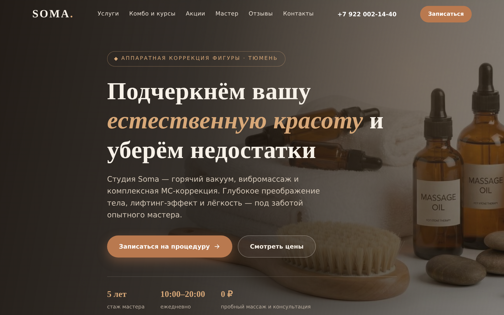

# SOMA — лендинг студии аппаратной коррекции фигуры (Тюмень)

Улучшенный аналог сайта-оригинала [massage-soma.tilda.ws](https://massage-soma.tilda.ws): одностраничный лендинг студии **Soma** с прайсом, акциями, отзывами, сертификатами мастера и онлайн-записью.

<p align="center">
  
</p>

## Что внутри

- **Услуги и цены** — все процедуры из прайс-листа оригинала (МС-процедура, горячий вакуум, вибромассаж) с фотографиями
- **Комбо и курсы** — «Быстрая трансформация», «Интенсив 5+2», «Турбо Рельеф», «Горячая десятка» с расчётом выгоды
- **Акции** — промокод FIRST, «Приведи подругу», скидки на курсы
- **Бесплатный пробный массаж** — с пошаговыми условиями акции
- **Мастер и сертификаты** — фото мастера, сертификаты об обучении с увеличением по клику (лайтбокс)
- **Отзывы гостей**, FAQ, контакты с QR-кодом онлайн-записи dikidi
- Только inline **SVG-иконки** (никаких эмодзи), реальные фотографии студии в `assets/img/`
- Адаптивная вёрстка (десктоп / планшет / телефон), плавные анимации, без внешних библиотек

## Структура проекта

```
soma-site/
├── index.html              # страница
├── assets/
│   ├── css/style.css       # стили (переменные темы — в :root)
│   ├── js/main.js          # меню, анимации, FAQ, лайтбокс
│   └── img/                # фото процедур, мастер, сертификаты, QR, логотип
└── README.md
```

## Локальный запуск

Просто откройте `index.html` в браузере — сборка не нужна. Либо поднимите локальный сервер:

```bash
python3 -m http.server 8000
# http://localhost:8000
```

## Публикация на GitHub

```bash
git remote add origin https://github.com/<ваш-логин>/soma-site.git
git push -u origin main
```

**GitHub Pages:** Settings → Pages → Source: `main` / `(root)` → Save.
Сайт будет доступен на `https://<ваш-логин>.github.io/soma-site/` (все пути относительные, работает из коробки).

## Настройка под себя

- **Цвета** — переменные в начале `assets/css/style.css` (`--accent`, `--gold`, `--dark`…)
- **Фото** — замените файлы в `assets/img/`, имена сохраняйте
- **Контакты и цены** — ищите прямо в `index.html`

## Контакты студии

- **Адрес:** г. Тюмень, ул. Газовиков 73 к4, студия красоты «Opa»
- **Телефон:** +7 922 002-14-40
- **Запись:** [dikidi.ru/soma](https://dikidi.ru/soma) · **VK:** [vk.com/salon_soma](https://vk.com/salon_soma) · **Telegram:** [t.me/EvilDevil2016](https://t.me/EvilDevil2016)
- **Часы работы:** ежедневно 10:00–20:00

> Фотографии и тексты принадлежат студии Soma и взяты с её официального сайта для этого лендинга.
